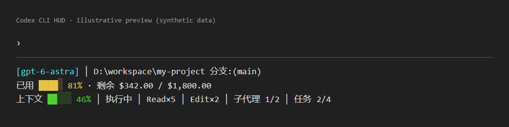

# Codex CLI HUD

[简体中文](README.zh-CN.md)

A Claude HUD-style statusline for Codex CLI: current provider quota, context usage, and session activity in a compact terminal footer.



*Illustrative preview with synthetic values; actual values come from your current session.*

## What it shows

- Model and working directory. Long paths are truncated to fit the terminal.
- Current provider balance or subscription windows, remaining allowance, and reset times when the provider supplies them.
- Context usage and native Codex run state.
- Tool call counts and active calls from the exact current thread's JSONL log. A returned call means it returned; it does not prove the operation succeeded.
- Confirmed subagent lifecycle events and the current plan, when available in that thread.

Quota adapters are built in. **CC Switch does not need to be installed or running, and its local configuration, database, accounts, and scripts are never read.** Provider protocols were adapted from CC Switch with its MIT notice retained.

Official mode uses the current Codex host's quota snapshot. Custom API mode queries the active provider without querying a separate official account. Missing quota/context data is shown as unavailable. Activity metrics are omitted when the matching thread log is unavailable. Only separately recorded tool calls are counted. Nested calls inside `functions.exec` are not inferred from its JavaScript source. The footer does not report live inference speed.

## Requirements

Custom gateways support both **HTTP and HTTPS**. The current Codex base URL (for example, `http://relay.example:8080/prefix/v1`) retains its scheme, port, and path prefix while detecting NewAPI, Sub2API, or general balance endpoints. No HTTP opt-in is needed. The gateway must expose a supported quota endpoint.

- Node.js 22 or newer and Python 3.11 or newer, available as `node` and `python`.
- Codex CLI with the experimental native statusline extension. Local integration was verified with **Codex CLI 0.171.0**; compatibility with other versions is not guaranteed.
- A terminal running Codex CLI. This footer is not a Codex desktop App extension. Full-screen mode and at least 80 columns are recommended.

Normal built-in quota queries have no npm dependencies and do not start a browser. The optional explicitly configured JavaScript sandbox requires Python Playwright and an installed Edge or Chrome browser; it is not part of the default installation.

## Install

```sh
git clone https://github.com/jiangwanyutao/codex-cli-hud.git
cd codex-cli-hud
node scripts/build-quota-plugin.js
codex plugin marketplace add ./dist/quota-marketplace
codex plugin add quota-hud@codex-quota-local
python scripts/configure-quota-hud.py
```

Restart Codex CLI after installation. The configuration helper backs up `config.toml` before selecting the statusline and preserves unrelated settings. Plugin IDs intentionally remain `quota-hud@codex-quota-local` and `codex-quota-hud` for upgrade compatibility.

To update, pull this repository, rebuild the marketplace, and update/reinstall that same plugin through your Codex CLI plugin manager, then restart Codex. To return to the default footer, use `/statusline`. To uninstall:

```sh
codex plugin remove quota-hud@codex-quota-local
```

## Provider support

The active provider is read from Codex's `config.toml`, `auth.json`, or the environment variable declared by that provider. The plugin automatically probes supported schemas at the configured origin and rejects redirects.

| Family | Built-in support |
| --- | --- |
| Sub2API | Balance, subscriptions, rate windows |
| NewAPI | API key usage; account quota with explicit management credentials |
| General balance | Compatible balance endpoints |
| Provider balances | DeepSeek, StepFun, SiliconFlow, OpenRouter, Novita |
| Coding plans | Kimi, Zhipu personal/team, MiniMax, ZenMux, Volcengine, OpenCode Go, Command Code, Ollama Cloud |
| GitHub Copilot | Explicit plugin OAuth credentials |
| Official Codex | Current host subscription quota snapshot |

Network queries refresh every 30 seconds by default; configuration is checked every 5 seconds. An explicitly configured `autoQueryInterval` is measured in minutes. Cached data remains visible while refreshing; transient failures mark it stale. Provider or credential changes discard the previous quota. Queries use read-only usage endpoints and do not send inference requests.

Additional management tokens, user IDs, AK/SK credentials, or team IDs cannot be inferred from an API URL. Missing required credentials are reported. The active custom provider has been exercised locally, while the wider adapter set is covered by fixtures and signing tests rather than live accounts on every platform.

## Optional configuration

Overrides belong to the plugin's own `~/.codex/quota-hud/providers.json`, or `$CODEX_HOME/quota-hud/providers.json`. Match `baseUrl` to the active Codex endpoint:

```json
{
  "providers": [
    {
      "baseUrl": "https://your-api.example/v1",
      "templateType": "newapi",
      "accessToken": "YOUR_MANAGEMENT_TOKEN",
      "userId": "YOUR_USER_ID"
    }
  ]
}
```

For an independent helper, explicitly set `command` and `args`. It receives credentials as JSON on stdin and returns JSON containing `total`, `used`, `remaining`, and/or `unit` on stdout. Only an explicit `scriptCode` override invokes the optional JavaScript sandbox. `usageBaseUrl` sets a separate usage endpoint; cross-origin script requests require an explicit `allowedOrigins` list of exact origins.

Do not run the private `quota-settings.py` helper directly or publish its output: it hands credentials to the collector. Use the sanitized checks instead:

```sh
node scripts/quota-hud.js --check
node scripts/quota-hud.js --preview
```

Standalone `--check` has no host subscription snapshot, so official quota may be unavailable there even when it appears in Codex.

## Development

```sh
npm run check
npm test
npm run build
```

No `npm install` is required. CI runs normal checks and tests on Windows and Linux with Node 22 and Python 3.12. `npm run test:sandbox` is a separate optional test requiring the browser sandbox prerequisites. Build output is `dist/quota-marketplace`; generated output and local credentials are not committed.

## License and credits

MIT — copyright 2026 jiangwanyutao. See [LICENSE](LICENSE) and [THIRD_PARTY_NOTICES.md](THIRD_PARTY_NOTICES.md) for retained Brandon Wie / codex-hud and CC Switch notices. The compact visual layout is inspired by Claude HUD.
