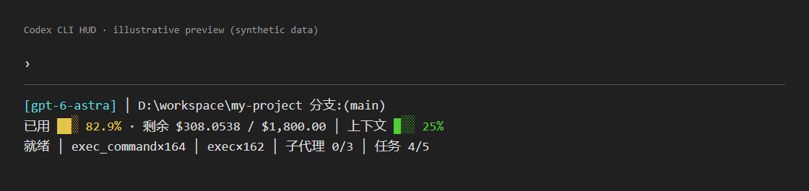

# Codex CLI HUD

[English](README.md)

Claude HUD 风格的 Codex CLI 状态栏：在紧凑的终端底栏中显示当前服务商额度、上下文占用和会话活动。



*示意图使用模拟数据；实际数值来自当前会话。*

原生底栏分为三行：模型与目录；额度与上下文并排；运行状态与工具活动。长内容按页轮换，上下文始终固定显示。

## 显示内容

- 模型和工作目录；路径过长时按终端宽度截断。
- 当前服务商余额或订阅窗口、剩余额度，以及接口提供的重置时间。
- 上下文占用和 Codex 原生运行状态。
- 从当前线程精确匹配的 JSONL 日志统计工具调用次数和活动调用。调用已返回只表示返回，不代表操作成功。
- 日志中已确认的子代理生命周期和当前计划。

额度查询协议内置于插件。**不需要安装或运行 CC Switch，也不读取其本地配置、数据库、账号或脚本。** 部分协议移植自 CC Switch，保留其 MIT 许可声明。

官方模式使用当前 Codex 宿主提供的额度快照。自定义 API 模式只查询当前服务商，不额外查询另一个官方账号。额度或上下文数据缺失时显示暂无数据；找不到匹配的线程日志时省略活动统计。只统计日志明确记录的调用，不从 `functions.exec` 的 JavaScript 源码猜测内嵌调用；不显示实时推理速度。

## 环境要求

自定义中转站同时支持 **HTTP 和 HTTPS**。直接使用当前 Codex 配置中的地址（例如 `http://relay.example:8080/prefix/v1`），保留协议、端口和路径前缀，自动识别 NewAPI、Sub2API 或通用余额接口，无需单独开启 HTTP。中转站需要提供对应的额度查询接口。

- Node.js 22+、Python 3.11+，终端可执行 `node` 和 `python`。
- 支持实验性原生状态栏扩展的 Codex CLI。本地已在 **Codex CLI 0.171.0** 验证，其他版本兼容性未经保证。
- 在终端运行 Codex CLI；这不是 Codex 桌面 App 扩展。建议全屏模式、至少 80 列。

常规内置查询没有 npm 依赖，也不启动浏览器。只有用户显式配置的 JavaScript 沙箱需要 Python Playwright 和本机 Edge 或 Chrome，不属于默认安装步骤。

## 安装

```sh
git clone https://github.com/jiangwanyutao/codex-cli-hud.git
cd codex-cli-hud
node scripts/build-quota-plugin.js
codex plugin marketplace add ./dist/quota-marketplace
codex plugin add quota-hud@codex-quota-local
python scripts/configure-quota-hud.py
```

安装后重启 Codex CLI。配置工具修改前会备份 `config.toml`，保留其他配置。为兼容升级，插件标识继续使用 `quota-hud@codex-quota-local` 和 `codex-quota-hud`。

更新时拉取仓库、重新构建 marketplace，再通过当前 Codex CLI 插件管理器更新或重装同一个插件，并重启 Codex。恢复默认底栏可使用 `/statusline`。卸载：

```sh
codex plugin remove quota-hud@codex-quota-local
```

## 支持的平台

从 Codex 当前 `config.toml`、`auth.json` 或服务商声明的环境变量读取配置，在指定源站自动探测支持的响应结构，并拒绝重定向。

| 类型 | 内置支持 |
| --- | --- |
| Sub2API | 余额、订阅、速率窗口 |
| NewAPI | API Key 用量；显式提供管理凭据后可查询账号额度 |
| 通用余额 | 兼容的余额接口 |
| 服务商余额 | DeepSeek、StepFun、SiliconFlow、OpenRouter、Novita |
| Coding Plan | Kimi、智谱个人/团队、MiniMax、ZenMux、火山引擎、OpenCode Go、Command Code、Ollama Cloud |
| GitHub Copilot | 插件显式配置的 OAuth 凭据 |
| 官方 Codex | 当前宿主订阅额度快照 |

默认每 30 秒刷新网络额度、每 5 秒检查配置。显式配置的 `autoQueryInterval` 单位是分钟。刷新期间继续显示缓存，临时查询失败标记旧数据；服务商或凭据变化后丢弃旧额度。查询只读用量接口，不发送推理请求。

管理 Token、用户 ID、AK/SK、团队 ID 无法从 URL 推断，缺失时会明确提示。当前自定义服务商已经过本地真实查询；其余适配器主要通过模拟响应和签名测试验证，没有逐个平台真实账号验收。

## 可选配置

插件自己的覆盖文件为 `~/.codex/quota-hud/providers.json`，或 `$CODEX_HOME/quota-hud/providers.json`。`baseUrl` 应匹配当前 Codex 端点：

```json
{
  "providers": [
    {
      "baseUrl": "https://your-api.example/v1",
      "templateType": "newapi",
      "accessToken": "YOUR_MANAGEMENT_TOKEN",
      "userId": "YOUR_USER_ID"
    }
  ]
}
```

独立查询程序可显式配置 `command` 和 `args`，通过 stdin 接收 JSON 凭据，通过 stdout 返回包含 `total`、`used`、`remaining` 或 `unit` 的 JSON。只有显式设置 `scriptCode` 才会使用可选 JavaScript 沙箱。`usageBaseUrl` 指定独立查询地址；跨源脚本请求必须通过 `allowedOrigins` 明确列出精确源站。

不要直接运行私有 `quota-settings.py` 或公开其输出，它负责向采集器传递凭据。使用脱敏检查：

```sh
node scripts/quota-hud.js --check
node scripts/quota-hud.js --preview
```

独立 `--check` 不包含宿主订阅快照，因此官方额度可能在该命令中显示暂无数据，而在 Codex 内正常显示。

## 开发验证

```sh
npm run check
npm test
npm run build
```

不需要 `npm install`。CI 在 Windows、Linux 上使用 Node 22 和 Python 3.12 执行常规检查和测试。`npm run test:sandbox` 单独验证可选浏览器沙箱，需要对应环境。构建输出位于 `dist/quota-marketplace`；生成产物和本地凭据不提交到仓库。

## 许可与致谢

MIT，版权所有 2026 jiangwanyutao。参见 [LICENSE](LICENSE) 与 [THIRD_PARTY_NOTICES.md](THIRD_PARTY_NOTICES.md)，其中保留 Brandon Wie / codex-hud 和 CC Switch 的许可声明。紧凑布局参考 Claude HUD。
